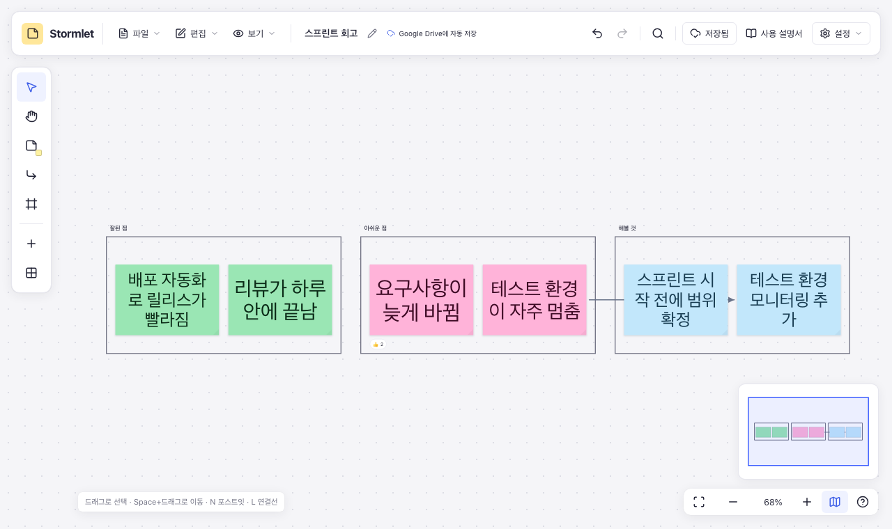

# Stormlet

[](https://github.com/sejoung/Stormlet/actions/workflows/ci.yml)
[](LICENSE)


포스트잇으로 생각을 펼치고 정리하는 로컬 우선 보드. [English](README.md)

로그인과 서버 없이 브라우저에서만 동작한다. 보드는 브라우저 저장소에 자동 저장되고, 읽을 수 있는 JSON인 `.stormlet` 파일로 내려받을 수 있다.



처음이라면 [사용 설명서](https://sejoung.github.io/Stormlet/manual/)를 읽어 보세요([원본](public/manual/index.html)).

## 기능

**포스트잇**

- 포스트잇 도구나 `N`을 누르고 보드를 클릭해 추가한 뒤 바로 입력 (기본 160 × 160 정사각형). 도구 패널의 색상 칸을 보드로 끌어다 놓아도 추가(터치 지원)
- ‘가운데 붙이기’로 화면 가운데에 추가, ‘여러 개 한 번에’로 여러 줄을 한꺼번에 입력
- 엑셀·구글 시트 셀 붙여넣기 (최대 50행 × 100열, 메모당 3,000자)
- 16가지 색상, 메모 전체 굵게·기울임·밑줄, 텍스트 정렬, 정사각형·직사각형 전환
- 글자 크기는 메모 크기와 내용에 맞춰 자동 조절되고 스크롤이 생기지 않음. 직접 고른 크기는 글이 들어가는 동안 유지되고, 넘칠 크기는 목록에서 비활성
- 선택 후 바로 입력하거나 더블클릭·Enter로 편집. Enter/Esc로 완료, Shift+Enter로 줄바꿈. 한글 조합 중 Enter는 입력을 유지
- 편집 중 `Tab`은 오른쪽, `Ctrl/Cmd+Enter`는 아래에 같은 크기·스타일의 새 메모를 만들어 이어 쓰기
- 네 모서리 손잡이 드래그(Shift로 비율 유지, 방향키로 20px씩), 크기 프리셋, 너비·높이 직접 지정으로 크기 조절. 여러 메모를 선택하면 경계 상자로 함께 비례 조절
- 이동·크기 조절 중 포스트잇·프레임의 가장자리·가운데 맞춤 가이드, 같은 간격 스냅, 같은 크기 표시. `Ctrl/Cmd`를 누르면 스냅 없이 이동
- 여러 메모 정렬·간격 맞춤·크기 맞춤(가장 큰 값 기준)·격자 배치를 도구 막대·우클릭 메뉴·`Alt/Option` 단축키로 실행, 그룹·잠금
- 스타일(색·글자 서식) 복사·붙여넣기는 새로고침과 탭을 넘어 유지, 같은 색 메모 모두 선택
- 이모지 반응 추가·취소, 메모 내용 검색

**연결선**

- `L`이나 메모 주변 연결점 드래그로 포스트잇·프레임 연결. 이동·크기 변경 중에도 연결 유지
- 직선·둥근 꺾임선(기본)·곡선, 시작·끝 화살표, 색상(검정 포함 6색)·두께·점선·설명·잠금
- 한 선의 색상·두께·점선을 바꾸면 다음 선의 기본값이 되고, ‘모든 연결선에 이 스타일 적용’으로 보드 전체를 한 번에 맞춤
- 끝점을 끌어 다시 연결. 흐름 전체를 복제·복사하면 내부 연결선도 함께 처리

**프레임**

- `F`로 영역을 드래그해 생성(클릭하면 기본 크기), 선택한 포스트잇의 ‘프레임 만들기’로 감싸기. 가로·세로 레인 프리셋 제공
- 배경 없음 또는 색상 지정, 테두리 1·2·3·4·6·8px, 제목 더블클릭으로 이름 수정
- 프레임을 옮기거나 크기를 바꿀 때 다른 프레임·메모에 맞춤 가이드와 같은 간격·같은 크기 스냅
- 프레임을 이동·복제·복사하면 안에 있는 포스트잇·하위 프레임·연결선도 함께 처리. 메모를 밖으로 옮기면 프레임에서 제외
- 프레임 삭제는 내용 유지, 잘라내기는 내용까지 이동. 프레임을 잠가도 안의 메모는 개별 편집 가능

**보드**

- Space+드래그, 휠 버튼 드래그, 손 도구로 이동. 휠과 우측 하단 버튼으로 확대·축소
- 모든 메모/선택한 메모에 화면 맞춤 (`Alt/Option+1/2`)
- 20px 격자 보기와 격자에 맞추기를 `보기` 메뉴에서 따로 켜고 끔. 설정은 새로고침 후에도 유지
- 보드 전체를 보여 주는 미니맵. 클릭하거나 화면 영역을 끌어 이동하고, 방향키로도 이동. 열어 둔 상태는 새로고침 후에도 유지
- 포스트잇·프레임·연결선·빈 캔버스 우클릭 메뉴 (Shift+F10으로도 열기)
- 모든 변경의 실행 취소·다시 실행. 메모와 함께 지워진 연결선도 한 번에 복구
- 브라우저 자동 저장, 탭마다 자기 보드. 새 보드는 새 탭에서 열리고, 다시 열면 마지막 보드로 시작하며, 닫은 탭의 보드는 `파일 → 최근 보드`에 남음 ([ADR 0011](docs/adr/0011-board-per-tab.md))
- 선택 기능인 Google Drive 동기화. 연결하면 Drive가 기본 저장 위치가 됨: 툴바의 Drive 버튼으로 연결·저장하고, 고른 폴더는 모든 탭이 함께 써서 새 보드는 첫 편집 때 그 폴더에 저장되며, `Ctrl/Cmd+S`는 Drive에 저장. 보드를 Drive 폴더에 저장하거나 Drive에서 열기. 편집은 자동 저장되고 다른 곳의 변경은 합쳐지며, 실제 충돌만 선택을 묻는다 ([설정](docs/google-drive.md))
- `파일` 메뉴에서 보드 전체를 PNG(2배 해상도)나 SVG 이미지로 내보내기. 문서·메신저에 바로 올릴 수 있도록 흰 배경의 밝은 테마로 그림
- 상단 보드 제목을 더블클릭하거나 Enter/F2로 이름 수정. 이름은 다운로드 파일명에 반영
- 제목 아래 메뉴 막대. 명령마다 단축키를 함께 보여 줌: `파일`(새 보드, 최근 보드, 열기, 내려받기, PNG·SVG 내보내기, Google Drive), `편집`(실행 취소, 잘라내기·복사·붙여넣기, 복제, 삭제, 모두 선택, 그룹, 잠금, 검색), `보기`(확대·축소, 맞춰 보기, 미니맵, 격자), `설정`(언어, 단축키 도움말, 사용 설명서, 문제 해결). 사용 설명서는 툴바에서도 바로 열 수 있음
- 단축키 도움말(`F1`, `?`), 작은 화면과 다크 모드 지원
- 영어·한국어 화면. 브라우저 언어를 따르고(지원하지 않는 언어면 영어), 설정에서 바꿀 수 있음
- 진단 기능: 오류가 나면 빈 화면 대신 복구 화면, 브라우저가 저장을 못 하면 경고, 읽을 수 없는 저장본은 덮어쓰지 않고 따로 보관, 버그 리포트용 진단 정보 복사

반응은 프로필 표시 없이 브라우저의 로컬 식별자로 추가·취소한다.

## 단축키

| 동작                                | 단축키                               |
| ----------------------------------- | ------------------------------------ |
| 포스트잇 / 선택 / 손 도구           | `N` / `V` / `H`                      |
| 연결선 / 프레임 도구                | `L` / `F`                            |
| 메모 편집, 줄바꿈, 편집 완료        | `Enter`, `Shift+Enter`, `Esc`        |
| 다음 메모 이어 쓰기 (오른쪽 / 아래) | `Tab` / `Ctrl/Cmd+Enter`             |
| 복제                                | `Ctrl/Cmd+D`, `Alt/Option+드래그`    |
| 방향에 맞춰 복제                    | `Alt/Option+방향키`                  |
| 전체 선택                           | `Ctrl/Cmd+A`                         |
| 그룹 / 그룹 해제                    | `Ctrl/Cmd+G` / `Ctrl/Cmd+Shift+G`    |
| 잠금 전환                           | `Ctrl/Cmd+Shift+L`                   |
| 굵게 / 기울임 / 밑줄                | `Ctrl/Cmd+B` / `I` / `U`             |
| 위치 조절 (Shift로 10px씩)          | 방향키                               |
| 왼쪽 / 가로 가운데 / 오른쪽 맞춤    | `Alt/Option+A` / `H` / `D`           |
| 위쪽 / 세로 가운데 / 아래쪽 맞춤    | `Alt/Option+W` / `V` / `S`           |
| 가로 / 세로 간격 맞춤               | `Alt/Option+Shift+H` / `V`           |
| 스타일 복사 / 붙여넣기              | `Ctrl/Cmd+Alt/Option+C` / `V`        |
| 크기 조절: 비율 유지 / 스냅 없이    | `Shift` / `Ctrl/Cmd` + 모서리 드래그 |
| 스냅 없이 옮기기                    | `Ctrl/Cmd` 누른 채 드래그            |
| 실행 취소 / 다시 실행               | `Ctrl/Cmd+Z` / `Ctrl/Cmd+Shift+Z`    |
| 모든 메모 / 선택한 메모 보기        | `Alt/Option+1` / `2`                 |
| 검색                                | `Ctrl/Cmd+F`                         |
| 보드 파일 열기 / 저장               | `Ctrl/Cmd+O` / `Ctrl/Cmd+S`          |
| 도움말                              | `F1`, `?`                            |

## 시작하기

Node 24가 필요하다 ([`.nvmrc`](.nvmrc) 참고).

```sh
git clone https://github.com/sejoung/Stormlet.git
cd Stormlet
npm install
npm run dev      # http://127.0.0.1:5173
```

`npm run build`는 상대 경로로 된 정적 사이트를 `dist/`에 만든다. 어떤 정적 호스팅이나 하위 경로에서도 그대로 서비스할 수 있다.

Google Drive는 선택 기능이다. `.env.example`을 `.env.local`로 복사해 Google 공개 설정 세 개를 넣으면 켜진다. Google Cloud 설정은 [docs/google-drive.md](docs/google-drive.md)를 참고한다.

## 스크립트

| 스크립트                 | 설명                                                |
| ------------------------ | --------------------------------------------------- |
| `npm run dev`            | 개발 서버 실행                                      |
| `npm run build`          | 타입 검사 후 `dist/`에 빌드                         |
| `npm run verify`         | 포맷 검사, 린트, 타입 검사, 테스트와 커버리지, 빌드 |
| `npm test`               | 단위 테스트 (Vitest, jsdom)                         |
| `npm run test:e2e`       | E2E 테스트 (Playwright, Chromium)                   |
| `npm run manual:capture` | 사용 설명서 화면 다시 캡처 (`public/manual/images`) |
| `npm run arch`           | 계층 의존 규칙 보고서                               |
| `npm run format`         | Prettier로 포맷                                     |

### E2E 테스트

Playwright로 실제 Chromium에서 실행한다. 포스트잇과 글자 크기 맞춤, 프레임, 연결선, 우클릭 메뉴, 다크 모드, 좁은 화면을 검증한다.

```sh
npm run test:e2e:install  # 최초 1회 Chromium 설치
npm run test:e2e          # E2E 전체 실행
npm run test:e2e:headed   # 브라우저 창을 보면서 실행
npm run test:e2e:ui       # Playwright UI에서 실행·디버깅
```

테스트 서버는 4173 포트에서 자동 실행되고 테스트가 끝나면 종료된다. HTML 보고서는 `playwright-report/index.html`, 화면 캡처는 `test-results/e2e`에 저장한다. 실패한 테스트의 추적 기록과 영상도 남긴다. CI는 모든 push와 pull request에서 `verify`와 E2E를 실행한다.

### 배포 (GitHub Pages)

백엔드 없이 정적 파일만으로 동작한다. 보드는 브라우저에, Drive 파일은 브라우저가 Google API로 직접 읽고 쓴다.

1. 저장소 **Settings → Pages**에서 Source를 **GitHub Actions**로 둔다.
2. Drive를 켜려면 **Settings → Secrets and variables → Actions → Variables**에 `VITE_GOOGLE_CLIENT_ID`, `VITE_GOOGLE_API_KEY`, `VITE_GOOGLE_APP_ID`를 넣는다. 공개 설정이라 Secrets가 아니어도 된다. 없으면 Drive 없이 배포하고 실행 기록에 경고를 남긴다. Google Cloud에는 배포 origin(`https://<계정>.github.io`)을 등록한다([설정](docs/google-drive.md)).
3. **Actions → Pages → Run workflow**로 직접 실행한다. `verify`와 E2E가 모두 통과해야 배포한다.

## 구조

| 계층              | 역할                                                                                         |
| ----------------- | -------------------------------------------------------------------------------------------- |
| `src/domain`      | 보드 모델, 패치, 명령, 프레임, 연결선, `BoardStore` 인터페이스                               |
| `src/application` | 편집 세션, 역패치 기반 실행 취소, Google Drive 동기화                                        |
| `src/engine`      | 뷰포트, 글자 크기 맞춤, 스냅, 연결선 경로, 붙여넣기 해석, 화면 맞춤                          |
| `src/adapters`    | `.stormlet` 파일 포맷, localStorage 저장소, Google Drive, 클립보드, 파일 다운로드, 진단 로그 |
| `src/components`  | 캔버스, 포스트잇, 프레임, 연결선, 툴바, 메뉴, 대화상자                                       |
| `src/app`         | 조립, 세션 훅, 단축키                                                                        |
| `src/i18n`        | 언어별 메시지 카탈로그와 번역 함수                                                           |

의존은 `app`에서 `domain` 쪽 안으로만 향한다. 이 규칙은 `tests/architecture`의 테스트로 강제하고, 린트는 파일당 400줄, 폴더당 파일 10개를 넘지 않게 검사한다.

설계 결정은 [docs/adr](docs/adr)에 있다. 모델은 나중에 로컬 저장소를 CRDT 저장소로 바꿀 수 있게 설계했다 ([ADR 0002](docs/adr/0002-collaboration-ready-model.md)).

### 파일 포맷

`.stormlet` 파일은 `format`과 `version` 필드가 있는 JSON이다. 현재 버전 9에는 제목, 메모, 연결선(검정 포함), 프레임과 그 서식이 저장된다. 버전 1–8 파일도 열 수 있다.

### 번역

화면 문구는 [`src/i18n/locales`](src/i18n/locales)에 언어별 파일 하나로 있고, 코드는 `t('toolbar.undo')`처럼 키로 참조한다. `en.ts`가 모든 키의 기준이자 기본 언어다. 새 언어를 추가하려면 `en.ts`를 `<언어 코드>.ts`로 복사해 값을 번역하고(`{자리 표시자}`는 유지), [`src/i18n/messages.ts`](src/i18n/messages.ts)의 `LOCALES`와 카탈로그 목록에 등록한다. 빠진 키나 자리 표시자는 타입 검사와 테스트가 잡는다. 자동으로 만드는 보드·프레임 제목은 모든 언어에서 영어다([ADR 0008](docs/adr/0008-i18n.md)).

## 다음 후보

- 실시간 협업: `BoardStore`의 Yjs 구현과 릴레이 서버 ([ADR 0002](docs/adr/0002-collaboration-ready-model.md))

## 버그 신고

**설정 → 문제 해결 → 진단 정보 복사**를 눌러 나온 내용을 [GitHub 이슈](../../issues/new?template=bug_report.md)에 붙여 넣어 달라. 앱 버전, 브라우저, 보드 크기, 저장 공간 사용량, 최근 로그(오류, 저장 실패 등)가 들어 있고 포스트잇 내용은 들어 있지 않다. 같은 로그는 브라우저 콘솔에도 `[stormlet]` 접두어로 출력된다([ADR 0009](docs/adr/0009-diagnostics.md)).

## 기여하기

이슈와 pull request를 환영한다. pull request를 올리기 전에 `npm run verify`와 `npm run test:e2e`가 통과하는지 확인해 달라. 큰 변경은 먼저 이슈로 방향을 의논하자.

## 라이선스

[MIT](LICENSE) © sejoung kim
